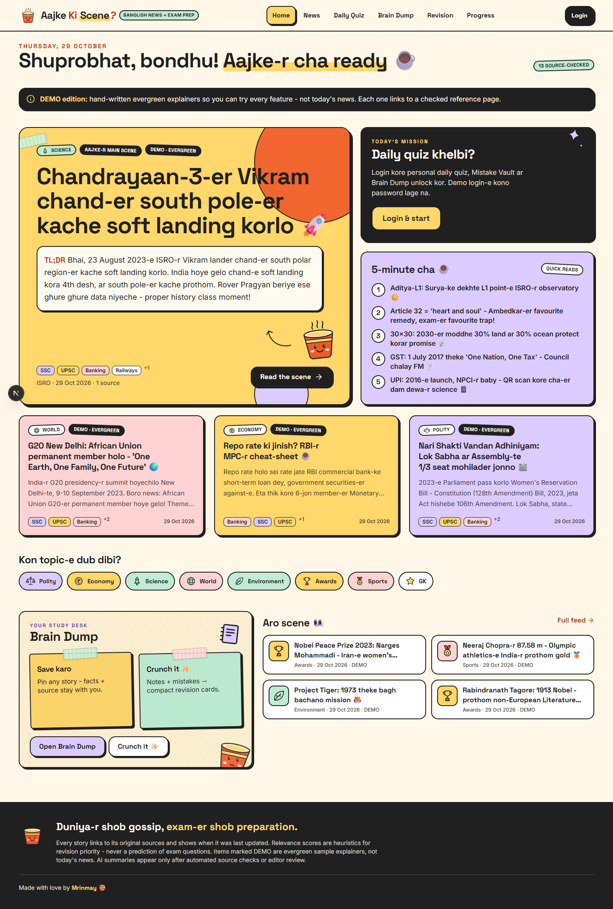

# Aajke Ki Scene? ☕

**Duniya-r shob gossip, exam-er shob preparation.** A Banglish-first current-affairs and
exam-prep web app: a source-checked daily edition, a personalised daily quiz with a
Mistake Vault, a scrapbook "Brain Dump" for notes and saved articles, and **Crunch It ✨**,
which turns your own material into cited revision points and spaced-repetition flashcards.



Stack: Next.js 16 (App Router, TypeScript, Tailwind 4, Auth.js) · FastAPI + SQLAlchemy 2 +
Alembic · PostgreSQL (Neon in production, embedded Postgres locally) · Python worker with a
quota-safe Gemini + Groq AI orchestrator.

## What works today

| Area | State |
|---|---|
| Local stack, migrations, seed | Working on Windows without Docker (embedded Postgres 18); `docker-compose.yml` optional |
| News feed, article pages, daily edition | Working. Demo edition = 13 hand-written, clearly labelled **DEMO** evergreen explainers with checked reference links |
| Live ingestion | Implemented for PIB RSS, RBI press RSS, UN News RSS, GDELT DOC API (+ Google News RSS, disabled by default for licensing). Off until `ENABLE_LIVE_INGESTION=true` |
| AI generation (Gemini + Groq) | Implemented and tested with simulated providers (success, 429, 503, daily quota, auth errors, invalid output, prompt injection). **Not activated**: needs your API keys + quota budgets |
| Daily quiz, Mistake Vault, practice quizzes | Working (deterministic selection, no AI calls) |
| Brain Dump: stickies, snapshots, collections API | Working (drag board on desktop, list view, keyboard moves) |
| Crunch It | Working with the **offline engine** (deterministic, nothing leaves the server). AI engine ready, consent-gated |
| Revision (SM-2 flashcards), Progress, Settings, Onboarding, Admin desk | Working |
| Auth | Auth.js: demo login in DEMO_MODE; GitHub/Google OAuth when configured |

Verified on this machine: `ruff`, `mypy`, **101 pytest tests** on real Postgres, ESLint,
`tsc`, **8 Vitest tests**, `next build`, and **2 Playwright end-to-end tests** against the
running stack. Screenshots of every screen at 375 / 768 / 1440 px live in
[`docs/screenshots/`](docs/screenshots/).

A real one-off ingestion into a temporary database (`scripts/live_ingestion_check.py`)
fetched 10 RBI press releases and 30 UN News items, clustered them into 40 events and built
an edition. **Blocked here, not by the code:** from the development network `pib.gov.in`
answered with an Akamai 403 (recorded, never bypassed) and `api.gdeltproject.org` was
unreachable behind TLS interception, so those two adapters are verified with fixtures. No
Gemini/Groq keys were available, so no real model call has been made.

## Quick start (Windows, macOS, Linux)

Prerequisites: **Node.js 20.9+** and **[uv](https://docs.astral.sh/uv/)** (uv installs
Python for you). No credentials are needed for DEMO mode.

```bash
npm install          # web app + embedded Postgres binaries
uv sync              # API + worker Python environment
npm run setup        # creates .env with generated local secrets
npm run dev          # local Postgres -> migrations -> demo seed -> API + worker + web
```

Open <http://localhost:3000>, click **Login**, type any name (use `admin` to see the admin
desk). API docs: <http://localhost:8000/docs>.

> Windows PowerShell may block `npm.ps1`; use `npm.cmd` instead of `npm` if you see
> "running scripts is disabled". The local Postgres data directory lives outside the repo
> (`%LOCALAPPDATA%\aajke-ki-scene\pgdata`) - never inside a OneDrive/Dropbox folder.

### Individual processes

| Command | What it does |
|---|---|
| `npm run db:start` / `db:stop` / `db:status` | Embedded Postgres on 127.0.0.1:54329 (creates `aajke` + `aajke_test`) |
| `npm run db:migrate` | `alembic upgrade head` (uses `DIRECT_URL`) |
| `npm run db:seed` | Source registry + DEMO content (idempotent) |
| `npm run dev:api` | FastAPI on :8000 |
| `npm run dev:worker` | Coordinator loop (ingestion if enabled, AI queue, offline Crunch, editions) |
| `npm run dev:web` | Next.js on :3000 |
| `uv run python -m worker ingest --allow-live --source rbi-press` | One-off live fetch with operator consent |
| `uv run python -m worker sync-models` | Checks configured model IDs against each provider's model list |
| `uv run python -m app.cli grant-admin you@example.com` | Admin role for an OAuth user |

## Using Neon

1. Create a Neon project → **Connect**. Copy the **pooled** string (host contains
   `-pooler`) into `DATABASE_URL` and the **direct** string into `DIRECT_URL`.
2. `npm run db:migrate` then `uv run python -m app.cli seed-sources` (add `seed-demo` only
   if you want demo content in that database).
3. Set `DEMO_MODE=false` and configure OAuth (`AUTH_GITHUB_*` / `AUTH_GOOGLE_*`),
   `ADMIN_EMAILS`, and a strong `AUTH_SECRET` + `API_JWT_SECRET`.

Prepared statements are disabled automatically for pooled connections; the worker's
single-coordinator guard is a lease row, so it also works through the pooler.

## Turning on live news and AI

* **Ingestion**: set `INGESTION_CONTACT` (URL or e-mail for the crawler user agent) and
  `ENABLE_LIVE_INGESTION=true`. Sources and their legal notes: [`docs/source-licenses.md`](docs/source-licenses.md).
  To test the feeds from your network without touching your data:
  `uv run python scripts/live_ingestion_check.py rbi-press un-news pib gdelt`.
* **Gemini**: `ENABLE_GEMINI=true`, `GEMINI_API_KEY`, `GEMINI_MODEL`, and budgets from *your*
  AI Studio quota page (`GEMINI_RPM_BUDGET`, `GEMINI_RPD_BUDGET`, `GEMINI_TPM_BUDGET`).
  The worker refuses to call a provider until its RPD/RPM budgets are set.
* **Groq** (optional fallback): `ENABLE_GROQ=true`, `GROQ_API_KEY`, `GROQ_MODEL_*`, budgets.
* Run `uv run python -m worker sync-models` to verify model IDs, then watch the admin desk.

Budgets are multiplied by the safety factor (default 0.65). Gemini daily quotas reset at
midnight **America/Los_Angeles**; the ledger tracks that, not UTC midnight. Details:
[`docs/architecture.md`](docs/architecture.md) and [`docs/operations.md`](docs/operations.md).

## Tests

```bash
npm run db:start                     # pytest needs the local (or a test) Postgres
uv run pytest                        # API + worker: 101 tests, real Postgres (wipes TEST_DATABASE_URL)
npm run lint && npm run typecheck    # ruff, ruff format --check, mypy, ESLint, tsc
npm run test --workspace apps/web    # Vitest
npm run test:e2e                     # Playwright (starts the stack if it isn't running)
```

If `npx playwright install` can't download browsers (corporate TLS inspection), use an
installed browser: `PLAYWRIGHT_CHANNEL=chrome` or `msedge`. Live-network tests are opt-in:
`RUN_LIVE_TESTS=1 uv run pytest -m live`. Visual QA screenshots:
`npm run screenshots --workspace apps/web`. Full plan: [`docs/test-plan.md`](docs/test-plan.md).

## Layout

```text
apps/web        Next.js app: pages, Chaotic Cozy design system, Auth.js, /api/backend proxy
apps/api        FastAPI app: models, Alembic migration, services, /api/v1 routers, seed data
apps/worker     Ingestion adapters, dedupe/relevance, AI orchestrator, quota ledger, Crunch engine
packages/shared-schemas  JSON Schemas of the AI output contracts
docs/           Architecture, sources & licences, prompts, test plan, operations, screenshots
scripts/        setup, embedded Postgres, dev runner, schema export
```

## Privacy and safety in one paragraph

User-facing pages never call an AI provider; they read precomputed data. Private notes
leave the server only for an AI Crunch the user explicitly consented to, and never go to a
fallback provider unless both the user and the server allow it. Every story keeps its
sources and timestamps; AI text appears only after automated evidence checks or editor
approval; sensitive stories get a serious tone and always go to editor review. DEMO items are
labelled everywhere.
