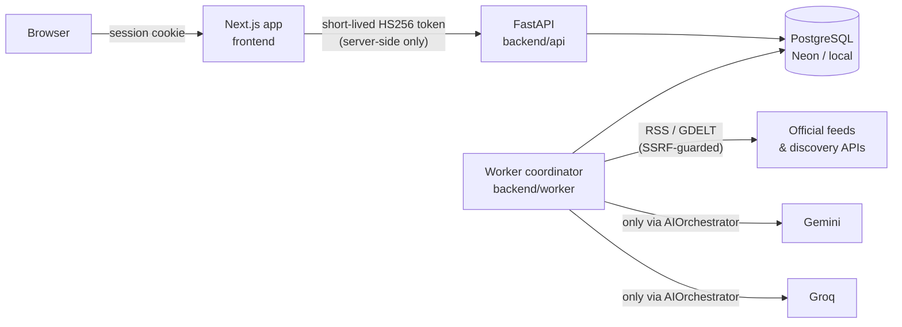

# Architecture

## Components



* **frontend** - Next.js App Router. Server components fetch FastAPI with a freshly minted
  5-minute token (`lib/server/token.ts`). Client components call the same-origin proxy
  `/api/backend/*`, which allow-lists API areas, rejects cross-site writes (Origin /
  `Sec-Fetch-Site`) and attaches the token. The browser never sees an API token or AI key.
* **backend/api** - FastAPI + SQLAlchemy 2 + Alembic + psycopg 3. Owns users, content and all
  private study data. Every private query is scoped by `user_id` in the service layer; foreign
  IDs return 404 (no existence leaks). Admin rights are read from the database per request.
* **backend/worker** - the single project-wide coordinator: ingestion, clustering, relevance,
  AI job processing, offline Crunch and daily editions. A lease row (`worker_leases`)
  guarantees one active coordinator even across redeploys and through Neon's pooler.
* **PostgreSQL** - the only stateful dependency: content, user data, the AI job queue,
  the quota ledger and audit log. No Redis is needed for the MVP.

## Request boundaries

* User-facing GETs read precomputed rows and never call an AI provider.
* Notes CRUD, quiz answers and flashcard reviews are plain database writes - they keep
  working during any AI outage.
* `POST /api/v1/crunch` is idempotent on `(user_id, input_digest)` and returns `202 Accepted`
  with a job to poll; an identical request returns the cached output (`200`, `cached: true`).

## Auth

Auth.js (JWT session strategy) handles sign-in: GitHub/Google OAuth when configured and a
password-free demo login only when `DEMO_MODE=true`. On sign-in the Next.js server calls
`POST /api/v1/auth/sync` with an `internal`-scope token; FastAPI upserts the user (plan
`users` table) and returns its UUID, which goes into the session. Admins come from
`ADMIN_EMAILS` (or the `admin` demo user in DEMO_MODE) and are stored as `users.is_admin`.

## Ingestion pipeline (no AI)

```
due sources -> SafeFetcher (allowlist, public-IP check, robots.txt, per-host pacing,
               size cap, bounded retries) -> adapter (RSS / GDELT) -> normalise
            -> upsert source_items by canonical URL (corrections keep title history)
            -> cluster: content fingerprint, then fuzzy headline similarity within 48 h
            -> deterministic relevance score + reasons + sensitive-story flag
```

`plan_news_jobs` then picks a few high-relevance, topic-diverse events and enqueues batched
`news_batch` jobs (up to 3 stories per call, capped by `AI_DAILY_NEWS_JOB_LIMIT`) - only if a
provider is operational. Without providers events stay visible as source headlines labelled
"AI summary pending".

## AI orchestration

All model calls go through `pipeline/ai_orchestrator.py`:

1. **Claim** a job from `ai_jobs` (`FOR UPDATE SKIP LOCKED`, leases, expired-lease reclaim).
2. **Prepare** via the job's handler (news batch or Crunch). Sources/notes are HTML-escaped
   and wrapped as untrusted data. Crunch re-reads the user's *current* consent.
3. **Candidates** from the routing table, filtered by: provider operational, model configured
   and not marked unavailable, paid models excluded unless `AI_ALLOW_PAID_FALLBACK=true`,
   private data only to the primary provider unless the user chose `allow_fallback` **and**
   `AI_ALLOW_PRIVATE_NOTES_PROVIDER_FALLBACK=true`.
4. **Reserve** budget in the quota ledger, **call**, **reconcile** actual usage.
5. **Validate** (schema + evidence checks) and **persist**; or try the next candidate.
6. At most `AI_MAX_PROVIDER_ATTEMPTS_PER_CYCLE` calls per cycle (default 2) - no ping-pong.
   Failures defer the job: `Retry-After` when given, otherwise full-jitter backoff with caps
   30 s / 2 min / 8 min / 30 min; daily-quota errors wait for the provider's reset. After
   `AI_MAX_JOB_ATTEMPTS` calls (default 4) the job is dead-lettered and its resource notified.

### Quota ledger (`pipeline/quota_manager.py`)

* `quota_state` row per `(provider, project_id, model)` plus a global row; every reservation
  and reconciliation locks the global row, so concurrent workers cannot double-spend.
* Daily counters are keyed by the provider's reset timezone (`GEMINI_DAILY_RESET_TZ`,
  default `America/Los_Angeles`; `GROQ_DAILY_RESET_TZ`, default `UTC`).
* Rolling 60-second RPM/TPM windows are computed from `ai_usage` rows, reservations included.
* Provider-wide minimum gap between requests, provider and global concurrency caps.
* Effective budget = configured budget × safety factor. Missing RPD/RPM budget = provider off.
* 429 minute limit → `blocked_until` = now + Retry-After; daily quota → next reset;
  3 consecutive 5xx/timeouts → circuit breaker (5 min, doubling, max 1 h); auth errors block
  for 6 h and surface in the admin desk. Groq `x-ratelimit-remaining-*: 0` headers block
  proactively until their reset.
* Reservations older than 10 minutes (crashed worker) are swept as `abandoned` and counted
  as spent, conservatively.

### Routing table

Defaults (`app/ai_config.py`), overridable with `AI_TASK_ROUTING_JSON`:

```json
{
  "news_batch": {"candidates": [["gemini", "default"], ["groq", "quality"], ["groq", "fallback"]],
                 "max_input_tokens": 6000, "max_output_tokens": 2048},
  "crunch":     {"candidates": [["gemini", "default"], ["groq", "fast"], ["groq", "fallback"]]},
  "classification": {"candidates": [["groq", "fast"], ["gemini", "default"]]}
}
```

A candidate is `[provider, model_role]` where `model_role` is `default` (Gemini),
`fast` / `quality` / `fallback` (Groq), or `id:<literal model id>`; add `"paid"` as a third
element to mark a paid model. `AI_PROVIDER_ORDER` re-sorts providers without dropping any.

### Scheduling fairness

User Crunch jobs have priority 100, news batches 70. While news jobs are waiting, AI Crunch
may use at most `AI_CRUNCH_DAILY_SHARE` (default 30%) of each provider's daily budget;
per-user limits (`CRUNCH_DAILY_LIMIT_PER_USER`, cooldown, item/char caps) apply at the API.

## Validation and publishing

`pipeline/validate.py` rejects malformed output (wrong events, schema violations) so another
candidate can try, and flags - without publishing - anything that cites unknown sources, has
numbers absent from the evidence, low word overlap with the evidence, model-reported
uncertainties, future dates, or is a sensitive story (always editor review; tone checked).
Articles that pass every check are published when `AI_AUTO_PUBLISH_VALIDATED=true`
(verification method `automated_evidence_check`), otherwise they go to the admin approval queue.
Article content is keyed by a hash of normalised source facts + prompt version + model +
tone, so each story is generated once for all readers.

## Crunch

`digest = SHA-256(prompt_version, engine, settings, sorted [(type, id, version)])` where the
version is a note's `revision_version` (bumped only on content edits, not on board moves),
a mistake's `revision_version`, or a snapshot's save time. The worker loads only rows owned
by the job's user. The offline engine extracts facts from snapshots, traps and Q→A cards from
mistakes, and bullets / `term: definition` cards from notes; every item keeps refs
(`N1`, `S2`, `M3`) and notes stay "user-provided, unverified".

## Spaced repetition

SM-2-inspired (`app/services/srs.py`, mirrored in `frontend/lib/srs.ts` for button labels):
*again* → relearn in 10 min, ease −0.2; *hard* → half the good interval, ease −0.15;
*good* → 1 d, 6 d, then interval × ease; *easy* → good × 1.3, ease +0.1; ease ∈ [1.3, 3.0],
intervals ≤ 365 d.

## Data model

All tables from plan section 5 exist in `backend/api/alembic/versions/0001_initial_schema.py`
(UUID keys, UTC timestamps, CHECK constraints for enums and `correct_index BETWEEN 0 AND 3`,
the partial unique index on `article_snapshots(user_id, article_id)`, per-user indexes).
Deviations, all additive: `ai_usage` is unique on `(job_id, attempt_no)` so a job may record
one row per provider attempt; `worker_leases` implements the single-coordinator lease;
`events`/`articles`/`questions` carry `is_demo`; `quiz_sessions.question_ids` freezes a
session's questions; `mistake_vault.revision_version` feeds Crunch digests.
